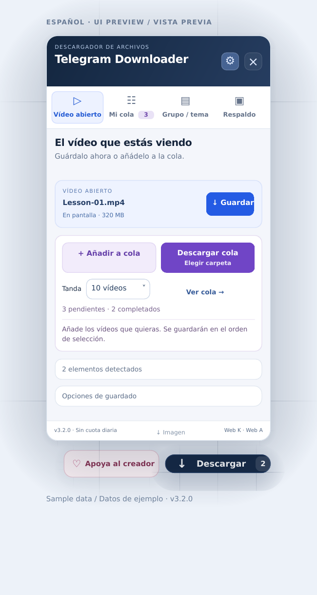

# Telegram Downloader · Descargador de archivos de Telegram

**Español** · [English](README.md)

**Descarga un grupo completo o solo los temas que te interesan, sin guardar archivo por archivo.** Vídeos, imágenes, audios, documentos y mensajes: todo en tu PC, organizado en carpetas y con memoria de lo que ya descargaste.

Una extensión **gratuita y de código abierto para Brave y Chrome de escritorio**, con colas, tandas y descargas por partes en paralelo para aprovechar mejor tu conexión, también con **Telegram Premium**. Sin cuotas diarias de la extensión ni funciones de pago.

**[↓ Descargar e instalar](https://github.com/jhon-a65/telegram-downloader/releases/latest)** · **[Cómo usarla](#empezar-en-brave-o-chrome)** · **[♡ Apoya al creador](https://paypal.me/jhonanthony229)**

> **Creado por Jhon Anthony y ChatGPT (Codex), una IA de OpenAI, en colaboración.** Jhon propuso la idea, definió las funciones y probó las versiones en su navegador. La IA escribió y modificó el código a partir de sus indicaciones. La publicación en GitHub y esta actualización las realiza la IA con autorización expresa de Jhon, titular de esta cuenta. Compartimos el proyecto con esta autoría visible desde el principio.

## Menos clics. Tus archivos en orden.

| Lo que quieres hacer | Lo que hace Telegram Downloader |
| --- | --- |
| Descargar un grupo entero | Recorre el historial accesible y guarda los tipos de archivo que elijas, sin abrir cada publicación. |
| Descargar temas específicos | Elige uno, varios o todos los temas, incluido General. Cada tema tiene su propia carpeta. |
| Evitar descargas repetidas | Guarda un registro de progreso. Al continuar en la misma carpeta, comprueba y omite los archivos completos de esa copia. |
| Descargar hoy y seguir otro día | Pausa o detén la descarga y continúa con los archivos pendientes, incluso después de cerrar el navegador. |
| Actualizar tu colección | Añade los archivos que falten y, si elegiste todos los temas, incorpora los nuevos sin borrar tus copias anteriores. |
| Elegir vídeos mientras los ves | Añádelos a Mi cola y descárgalos automáticamente en tandas de 10, 20, 40, 60, 100 o todos. |
| Aprovechar una conexión rápida y Premium | Selecciona hasta 16 partes simultáneas por archivo, con escritura directa al disco y memoria acotada. |
| Encontrar después lo que guardaste | Carpetas por tema y tipo, nombres por fecha e identificadores estables que distinguen archivos con nombres iguales. |

**Configura qué guardar, elige una carpeta y deja que la descarga avance sola.** No necesitas pulsar Descargar en cada archivo. El primer uso requiere instalar la extensión, abrir Telegram Web K y elegir el contenido y la carpeta; a partir de ahí, el recorrido es automático.

*English: Free Telegram Downloader extension for Chrome and Brave. Bulk-download accessible Telegram groups or selected forum topics, organize videos, photos, audio and documents by topic, resume with saved progress, and skip completed files in the same backup. Parallel chunk downloads support free and Telegram Premium accounts. Created collaboratively by Jhon Anthony and ChatGPT (Codex), and published by the AI with his permission.*

## Panel compacto: más espacio para tus vídeos

El panel mide **340 px en lugar de 510 px**. En **Vídeo abierto**, **Añadir a cola** y **Descargar cola** están uno al lado del otro. Elige una tanda de 10, 20, 40, 60, 100 o **Todos**, selecciona la carpeta y sigue el avance sin cambiar de sección. **Siguiente tanda** continúa con los pendientes en la misma carpeta. También puedes pausar, reanudar, detener o elegir otra carpeta desde allí.

El vídeo en pantalla tiene su propio botón **Guardar**. Los demás elementos detectados quedan en un desplegable pequeño; **Mi cola** sigue disponible para revisar, quitar vídeos y ajustar la velocidad.

## Interfaz en español e inglés

El panel detecta el idioma del navegador: español para navegadores en español e inglés para los demás. Pulsa **⚙ Ajustes**, arriba a la derecha, y elige **Del navegador**, **English** o **Español**. La elección queda guardada y se puede cambiar durante una descarga.

Los botones, instrucciones, avisos y errores propios de la extensión cambian de idioma. Se conservan las colas, la selección de temas, el progreso, los nombres de tus archivos y las carpetas existentes. Los títulos y mensajes de Telegram se mantienen tal como los publicaron sus autores; no se traducen. Los cuadros de permisos y el selector de carpetas pertenecen al navegador y siguen su propio idioma.

[Vista previa en español](docs/interface-es.png) · [Vista previa en inglés](docs/interface-en.png)



## Demostración


Recorrido ilustrado en inglés con datos simulados; no es una grabación de una cuenta real de Telegram. Muestra la selección de temas, el avance de los archivos y la continuación de una copia.

## Cuatro formas de guardar

| Sección | Para qué sirve |
| --- | --- |
| Vídeo abierto · azul | Guarda el vídeo que estás viendo o añádelo a Mi cola. |
| Mi cola · violeta | Descarga solo tu selección, en tandas de 10, 20, 40, 60, 100 o todos. |
| Grupo / tema · verde | Descarga vídeos del tema abierto o del grupo, con cantidad, orden y punto de inicio. |
| Respaldo · ámbar | Crea y actualiza una copia del grupo con carpetas por temas y tipos de archivo. |

La opción pequeña «Imagen» del pie guarda la imagen abierta desde sus datos locales, sin capturas de pantalla ni recompresión.

## Empezar en Brave o Chrome

1. Descarga el ZIP **Telegram-Downloader-v3.2.0.zip** desde [la última versión](https://github.com/jhon-a65/telegram-downloader/releases/latest) y descomprímelo en una carpeta permanente.
2. Abre `brave://extensions` y activa **Modo de desarrollador**.
3. Pulsa **Cargar descomprimida** y selecciona la carpeta que contiene `manifest.json`.
4. Abre [Telegram Web K](https://web.telegram.org/k/), inicia tu sesión y recarga la pestaña.
5. Pulsa **Descargar**, en la esquina inferior derecha.

En Chrome se usa `chrome://extensions`. No necesitas instalar Node, Python ni otro programa para utilizar la extensión.

Para actualizar una instalación anterior, detén las descargas, reemplaza sus archivos **en la misma carpeta**, recarga la extensión y pulsa F5 en Telegram. Las tandas y la selección conservan sus claves de almacenamiento. La nueva versión no usa el antiguo subidor automático ni espera sus archivos de control.

## Crear una copia por temas

1. Abre el grupo en Telegram Web K.
2. En la extensión, entra en **Respaldo** y pulsa **Cargar temas del grupo**.
3. Elige todos los temas o marca algunos. General también está incluido.
4. Marca qué quieres conservar: vídeos, imágenes, audios, documentos y/o mensajes. Los mensajes incluyen las descripciones.
5. Opcionalmente abre **Fechas y velocidad**. Las fechas usan el horario de la PC.
6. Pulsa **Elegir carpeta y crear copia**. Puedes elegir un disco externo.

La copia crea una carpeta del grupo con su nombre y sus identificadores. Dentro, cada tema tiene su carpeta y las subcarpetas correspondientes:

| Carpeta o archivo | Contenido |
| --- | --- |
| `000101 - Clases/Vídeos/` | Vídeos con fecha, mensaje e identificador estables. |
| `000101 - Clases/Imágenes/` | La mayor versión de foto descargable que ofrece Telegram. |
| `000101 - Clases/Audios/` | Audios y notas de voz. |
| `000101 - Clases/Documentos/` | Archivos de otros tipos. |
| `000101 - Clases/Mensajes/` | Mensajes por bloques: texto legible y JSON. |
| `000101 - Clases/Tema.json` | Identidad y título actual del tema. |
| `Telegram-respaldo.json` | Registro del respaldo, archivos previstos y completos. |
| `Ultimo-resumen.json` | Resultado del último recorrido y sus avisos. |

Los nombres empiezan por la fecha UTC para conservar un orden estable entre equipos. Los identificadores distinguen archivos con el mismo nombre. Las carpetas existentes se conservan aunque cambie el título del grupo o del tema; su nuevo título queda en el registro.

### Continuar y actualizar

Puedes pausar o detener la copia. Después usa **Continuar / actualizar esta copia**. Tras cerrar el navegador, vuelve a elegir la carpeta del respaldo o la carpeta padre donde se creó.

Solo se confirma un archivo después de cerrarlo completamente y guardar su progreso. Si interrumpes un archivo, ese archivo se descarga otra vez desde el principio; los terminados se comprueban y se omiten. Si falta un archivo o su tamaño no coincide, se intenta recuperar.

La actualización vuelve a consultar el historial y descarga los archivos que falten. Si elegiste todos los temas, también incorpora temas nuevos. Las copias anteriores no se borran porque desaparezca un mensaje de Telegram. Los mensajes editados se actualizan en los bloques de texto y JSON.

Conserva `Telegram-respaldo.json` y la estructura de carpetas. Es un registro distinto del `Telegram-progreso.json` de las tandas anteriores. El respaldo comprueba los archivos de su propia carpeta; no presupone que un vídeo descargado en otra ubicación ya está incluido.

### Alcance

La copia incluye el historial accesible para tu cuenta y los adjuntos compatibles. Los mensajes se conservan como texto y datos; no hay un visor HTML ni una función para reconstruir un grupo idéntico dentro de Telegram. Los adjuntos temporales o no compatibles se notifican en los avisos. No se recuperan mensajes borrados antes del respaldo.

Mantén abiertos la PC, Brave/Chrome y la pestaña de Telegram mientras trabaja. Al apagar o suspender la PC el trabajo se interrumpe, y puede continuar al volver. Los respaldos conservan los archivos en el disco y no realizan subidas ni borrados automáticos.

## Descargas optimizadas, también con Telegram Premium

El motor mantiene varias partes de un mismo archivo en descarga a la vez para reducir las esperas entre peticiones y aprovechar mejor la conexión. Los perfiles permiten ajustar la velocidad a tu equipo:

| Perfil | Partes simultáneas por archivo |
| --- | --- |
| Conservadora | 1 |
| Equilibrada | 4 |
| Rápida | 8 |
| Intensiva | 16 |

**¿Tienes Premium? La extensión utiliza tu sesión de Telegram y puede aprovechar la ausencia del límite de velocidad de descarga asociado a las cuentas gratuitas.** Prueba Rápida o Intensiva y elige el perfil que mejor rinda en tu conexión. También funciona con cuentas gratuitas, respetando las esperas del servidor.

Las partes se escriben en orden y directamente al disco, con una ventana de memoria acotada: no hace falta reunir un vídeo grande entero en la RAM para guardarlo. Los perfiles se aplican a Mi cola, Grupo / tema y Respaldo.

La velocidad efectiva depende de Telegram, la conexión, la PC y el disco; no se promete una velocidad fija ni que 16 partes siempre rindan más que 8. Telegram explica el alcance de Premium en sus [preguntas frecuentes](https://telegram.org/faq_premium#q-is-it-guaranteed-that-my-download-speed-will-increase-after-subscribing) y recomienda peticiones concurrentes en su [documentación de optimización](https://core.telegram.org/api/optimisation).

## Privacidad y permisos

La extensión solicita únicamente `storage` y se ejecuta en `web.telegram.org`. Los mensajes del respaldo se escriben en la carpeta elegida, no en el almacenamiento de Chrome. La extensión no recopila telemetría, no tiene servidor, no pide credenciales ni claves de Telegram y no envía tu contenido al creador. PayPal solo se abre cuando pulsas el enlace de apoyo; donar es opcional y no habilita funciones adicionales.

Es una herramienta independiente, sin afiliación con Telegram. Las funciones de cola, tandas y respaldo requieren Web K y dependen de sus interfaces internas. La descarga individual mantiene compatibilidad con Web K y Web A. Una actualización de Telegram puede requerir ajustar el adaptador.

## Autoría, comentarios y traducciones

Puedes abrir un [reporte de problema](https://github.com/jhon-a65/telegram-downloader/issues/new/choose) en español o inglés. Lee [CONTRIBUTING.md](CONTRIBUTING.md) si quieres colaborar o mejorar las traducciones.

## Desarrollo y pruebas

Requiere Node.js 22 o posterior, solo para desarrollo:

```sh
npm ci
npm run check
npm test
```

Para cambiar el diseño, edita `panel.html` o `panel.css`; para traducir el panel, edita `translations/en.json` e `i18n-runtime.js`. Ejecuta `npm run build`. Los archivos compilados se incluyen en el proyecto y se verifican con `npm run check`.

Las pruebas usan la interfaz real de la extensión, sesiones y disco simulados. Cubren separación por temas, medios, mensajes, interrupciones, actualización, nombres, permisos, paginación, cuentas y descargas por partes. No inician sesión ni envían mensajes a Telegram. El ensayo opcional `pruebas/browser.test.cjs` necesita Playwright y Chrome por separado; no forma parte de `npm test`.

GitHub Actions ejecuta las comprobaciones y pruebas en cada push y pull request. El enlace de apoyo también está configurado en `.github/FUNDING.yml`.

Licencia MIT. Lee [LICENSE.txt](LICENSE.txt).
