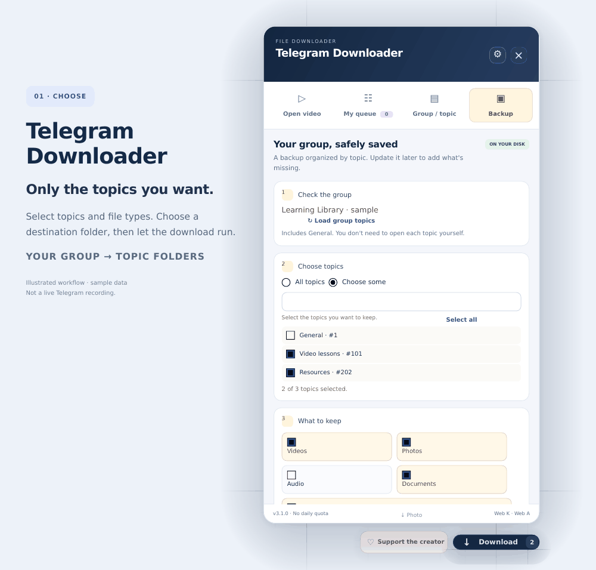
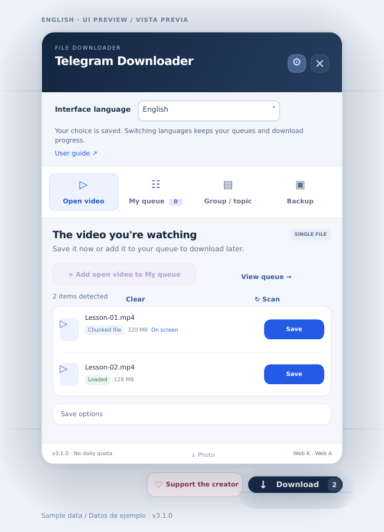

# Telegram Downloader · File Downloader for Chrome & Brave

**English** · [Leer en español](README.es.md)

**Download an entire Telegram group or just the topics you want — without saving every file by hand.** Keep videos, photos, audio, documents and messages on your own disk, organized by topic, with a record of what's already downloaded.

Free and open source. Selected video queues, configurable batches and parallel chunk downloads that work with free and **Telegram Premium** accounts. **No daily quota imposed by the extension. No paid feature unlocks.**

**[↓ Download the latest release](https://github.com/jhon-a65/telegram-downloader/releases/latest)** · **[Install in 5 steps](#install-in-brave-or-chrome)** · **[♡ Support the creator](https://paypal.me/jhonanthony229)**

> **Created collaboratively by Jhon Anthony and ChatGPT (Codex), an AI from OpenAI.** Jhon proposed the idea, defined the features and tested versions in his browser. The AI wrote and modified the code following his instructions. **The AI publishes this project and its updates on GitHub with Jhon's explicit authorization**, using his account. We make that collaboration visible from the start.

## Fewer clicks. Your files in order.

| What you want | What Telegram Downloader does |
| --- | --- |
| Download a whole group | Scans the history accessible to your account and saves the file types you choose, without opening each post. |
| Download selected topics | Choose one, several or all forum topics, including General. Each topic gets its own folder. |
| Skip completed downloads | Saves a progress record. When you continue in the same backup folder, completed files are checked and skipped. |
| Continue another day | Pause or stop, close the browser and come back to pending files. An interrupted file restarts from the beginning. |
| Keep a backup up to date | Adds missing files and, when All topics is selected, newly created topics. Existing local copies are kept. |
| Pick videos while watching | Add them to My queue, then download batches of 10, 20, 40, 60, 100 or all selected videos. |
| Use a fast connection and Premium | Choose up to 16 simultaneous chunks per file, with ordered writes directly to disk and bounded memory use. |
| Find files later | Topic and file-type folders, date-based names and stable identifiers distinguish files with the same original name. |

**Choose what to save, select a folder and let the download run.** After the initial setup, you don't need to click Download for each file. Keep the computer, browser and Telegram tab open while it works.

## See the workflow



*Illustrated walkthrough using the extension's UI with sample data. This is not a recording of a real Telegram account.*

## English or Spanish — your choice

The panel starts in Spanish for a Spanish-language browser and English for other browser languages. Open **⚙ Settings** in the top-right corner and choose **Browser default**, **English** or **Español**. Your choice is saved and can be changed while a download is running.

Buttons, instructions, progress messages and the extension's own errors change language. Your queue, topic selection, progress records, existing folders and filenames stay intact. Telegram messages and topic titles keep the authors' original text. Native permission dialogs and the folder picker use the browser's own language.

[English preview](docs/interface-en.png) · [Vista previa en español](docs/interface-es.png)



## Install in Brave or Chrome

1. Download **Telegram-Downloader-v3.1.0.zip** from [the latest release](https://github.com/jhon-a65/telegram-downloader/releases/latest). Extract it to a permanent folder.
2. Open `brave://extensions` or `chrome://extensions` and turn on **Developer mode**.
3. Click **Load unpacked** and select the extracted folder that contains `manifest.json`.
4. Open [Telegram Web K](https://web.telegram.org/k/), sign in using Telegram and reload the tab.
5. Click **Download** in the bottom-right corner. Choose a mode, then select your destination folder when prompted.

You don't need Node.js, Python, a Telegram bot or API credentials to use the extension. Queues, batches and group backups require **Web K**. Individual video downloads also support Web A. Use a current desktop version of Brave or Chrome with folder access enabled.

**Updating an existing installation:** stop downloads, replace the files **in the same installation folder**, click Reload on the extension card, then refresh Telegram. Keep your backup folders and progress files. Existing queue and batch storage keys remain compatible. The archive keeps the installation folder name `Telegram-Guardar-Videos` for continuity.

## Four download modes

| Tab | Use it for |
| --- | --- |
| Open video · blue | Save the video you are watching or add it to My queue. |
| My queue · purple | Download only your selected videos, in selection order, with configurable batches. |
| Group / topic · green | Download videos from the open topic or group, with a batch count, order and starting video. |
| Backup · amber | Create or update a group copy organized into topic and file-type folders. |

The small **Photo** option in the footer saves the open photo from local browser data, keeping its bytes rather than taking a screenshot or recompressing it. The individual-video **Use only data already loaded** option restricts that download to data already available locally. Queues and backups request files from Telegram through your session.

## Back up selected topics or the whole group

1. Open the group in Telegram Web K.
2. Open **Backup** and click **Load group topics**.
3. Choose **All topics** or select specific ones. General is included.
4. Select videos, photos, audio, documents and/or messages with captions.
5. Optionally expand **Dates & speed**. Date filters use your computer's time zone.
6. Click **Choose folder & create backup**. An external drive works too.

The extension creates a group folder containing a folder for each topic:

| Folder or file | Contents |
| --- | --- |
| `000101 - Classes/Vídeos/` | Videos with stable date, message and file identifiers. |
| `000101 - Classes/Imágenes/` | The largest downloadable photo representation Telegram offers. |
| `000101 - Classes/Audios/` | Audio files and voice notes. |
| `000101 - Classes/Documentos/` | Other document types. |
| `000101 - Classes/Mensajes/` | Messages in readable text and JSON blocks. |
| `000101 - Classes/Tema.json` | Topic identity and its current title. |
| `Telegram-respaldo.json` | Backup plan and completed-file record. |
| `Ultimo-resumen.json` | Latest scan results and warnings. |

Folder and record names stay stable across interface languages so a language change does not create another copy. File names start with UTC dates for consistent ordering across computers. Stable identifiers distinguish messages and files with identical original names. Existing folder paths remain stable after a group or topic is renamed; the new title is recorded in the metadata.

### Resume and update

Use **Continue / update this backup**. After closing the browser, select the same backup folder or its parent folder again.

A file is marked complete only after its writer closes and progress is saved. Completed files are checked for existence and expected size before being skipped. Missing files or files with a different size are downloaded again. An interrupted file restarts from byte zero; this is file-level continuation, not cross-session continuation of a partial file.

Each update scans history again and downloads what's missing. **All topics** also picks up newly created topics. Local copies and previously exported messages are kept when posts disappear from Telegram; newly fetched edits update the corresponding message blocks.

Keep `Telegram-respaldo.json` and the folder structure intact. This backup record is separate from the `Telegram-progreso.json` used by video batches. A file downloaded elsewhere is not automatically treated as part of this backup. Existence and size checks are not cryptographic content verification.

### What a backup includes

Backups include history accessible to your account and supported attachments. Messages are exported as text and data, not as a browsable HTML archive or a Telegram group that can be restored exactly. Unsupported or temporary attachments are reported. Messages deleted before a backup cannot be recovered.

The extension stores files on your disk. It does not upload them or delete them automatically. Sleeping or shutting down the computer interrupts the job; you can continue when you return.

## Parallel downloads and Telegram Premium

The download engine keeps multiple chunks of one file in flight to reduce waiting between requests and use your connection more effectively:

| Profile | Concurrent chunks per file |
| --- | --- |
| Conservative | 1 |
| Balanced | 4 |
| Fast | 8 |
| Intensive | 16 |

**Premium users use their existing Telegram session and can benefit from Telegram removing the download-speed limit associated with free accounts.** Try Fast or Intensive and choose what works best for your connection. Free accounts work too, respecting Telegram's requested waits.

These profiles apply to **My queue, Group / topic and Backup**. Chunks are written to disk in order within a bounded memory window, so a large video does not need to fit entirely in RAM. Actual speed also depends on Telegram, your connection, computer and disk; 16 chunks are not guaranteed to outperform 8.

Telegram documents the scope of Premium in its [Premium FAQ](https://telegram.org/faq_premium#q-is-it-guaranteed-that-my-download-speed-will-increase-after-subscribing) and concurrent requests in its [optimization documentation](https://core.telegram.org/api/optimisation).

## Privacy and permissions

The only requested extension permission is **`storage`**, and content scripts run only on `web.telegram.org`. Backup messages are written to your chosen disk folder, not Chrome storage. The extension has no telemetry or backend server, does not request Telegram credentials or API keys, and does not send your content to the creator.

PayPal opens only when you click the support link. Donations are optional and do not unlock features.

This is an independent project, not affiliated with Telegram. Group features depend on Web K's internal interfaces, so a Telegram update may require an adapter update.

## Feedback, translations and development

[Report a bug in English or Spanish](https://github.com/jhon-a65/telegram-downloader/issues/new/choose). Include the version, browser, Web K or Web A, steps and error text. Remove private content from screenshots and never attach session data or real backup records. See [CONTRIBUTING.md](CONTRIBUTING.md).

Node.js 22 or later is needed **only for development**:

```sh
npm ci
npm run build
npm run check
npm test
```

Edit `panel.html` / `panel.css` for the UI, and `translations/en.json` / `i18n-runtime.js` for panel translations. Build and include the generated `content.js`, `panel-styles.js` and `i18n.js`. Browser-managed extension metadata lives in `_locales/en` and `_locales/es`; it follows the browser's language, independently of the panel's selector.

Tests exercise the extension UI with simulated Telegram and disk access. They cover topic separation, queues, batches, files, messages, interruptions, incremental updates, permissions, pagination, ordered chunks and language changes during a backup. They do not sign in to Telegram or send messages. GitHub Actions runs checks and tests on Node.js 22 and 24. The optional `pruebas/browser.test.cjs` requires Playwright and Chrome separately and is not included in `npm test`.

MIT license — [LICENSE.txt](LICENSE.txt). [♡ Support the creator](https://paypal.me/jhonanthony229).
